# Audacity Dark Themes · thèmes sombres pour Audacity / dark themes for Audacity (Windows)

**🇫🇷 Français · 🇬🇧 English** (scroll down / plus bas)

---

## 🇫🇷 Enfin.

Minuit. Vous montez un podcast, un morceau, une interview. Et Audacity vous éclaire le visage comme un projecteur
de stade : fenêtre blanche, menus blancs, barre de titre blanche. Même son thème « Sombre » laisse passer le blanc.

**C'est terminé.**

Quatre thèmes sombres et modernes, pensés pour de longues heures d'écoute : boutons plats et arrondis, contrastes
adoucis, forme d'onde colorée. Et un petit module qui assombrit enfin ce qu'aucun thème ne touchait : la barre de titre,
les menus, la barre d'état, les ascenseurs et l'écran de démarrage.

Gratuit. Sans pub. Libre.
**Parce que c'est comme ça que ça devrait être.**

### Les 4 thèmes
| Thème | Ambiance |
|---|---|
| 🔵 **Minuit** | bleu nuit, accent bleu vif |
| 🟠 **Graphite** | gris doux, accent vert d'eau, forme d'onde orange |
| 🟣 **Améthyste** | violet profond, accent lavande |
| 🔴 **Braise** | brun chaud, accent corail |

### Ce que ça change
- 🌑 **Tout l'intérieur d'Audacity en sombre** : pistes, règle, barres d'outils, compteurs, listes déroulantes, cases à cocher.
- 🎛️ **Boutons modernisés** : transport, outils et curseurs redessinés, plats et arrondis.
- 🎨 **Forme d'onde colorée**, sélection teintée de l'accent du thème.
- 🪟 **Avec le module (facultatif)** : barre de titre, menus, barre d'état, ascenseurs et écran de démarrage en sombre.

### Installer un thème (le plus simple, 1 minute)
1. **Télécharger** : ouvrir [la dernière version](../../releases/latest) et cliquer sur le fichier `.zip`, puis le décompresser (clic droit › **Extraire tout…**).
2. **Copier le thème** : ouvrir le dossier `themes`, puis celui du thème choisi (par exemple `Graphite`), et copier son fichier `ImageCache.png`.
3. **Le coller** : taper `%APPDATA%\audacity\Theme\custom` dans la barre d'adresse de l'Explorateur, puis Entrée (créer le dossier `custom` s'il n'existe pas), et coller le fichier.
4. **L'activer** : dans Audacity, **Édition › Préférences › Interface › Thème › Personnalisé**, puis **OK**. C'est prêt !

Ou en un double-clic : `Choisir-theme.cmd`, puis taper le numéro du thème.

### Installer le module (facultatif : titre, menus et barre d'état sombres)
Audacity fermé, double-cliquer sur `Installer-tout.cmd`. Il remplace le thème « Sombre » d'Audacity par le vôtre (Graphite par défaut)
et installe le module `mod-sombre`. Ensuite, choisir **Sombre** dans les préférences d'Audacity.
- Il faut **Audacity 3.5.1** exactement (toute autre version est refusée, sans rien modifier) et **Python 3** ([python.org](https://www.python.org/downloads/)). Windows demande une autorisation administrateur.
- Le fichier d'origine d'Audacity est sauvegardé avant toute modification. **Tout retirer** : double-cliquer sur `Retirer-tout.cmd`.
- Une mise à jour d'Audacity annule le remplacement : il suffit de relancer `Installer-tout.cmd`.

> Ce projet n'est pas affilié à Audacity ni à Muse Group. Audacity® est une marque de Muse Group. Les images d'origine des
> thèmes (dossier `base`) viennent du projet Audacity, sous licence GPL.

---

## 🇬🇧 At last.

Midnight. You're editing a podcast, a song, an interview. And Audacity lights up your face like a stadium floodlight:
white window, white menus, white title bar. Even its "Dark" theme lets the white through.

**No more.**

Four modern dark themes, made for long listening sessions: flat rounded buttons, softer contrast, coloured waveform.
And a small module that finally darkens what no theme could reach: the title bar, menus, status bar, scrollbars and
the splash screen.

Free. No ads. Open source.
**Because that's the way it should be.**

### The 4 themes
| Theme | Mood |
|---|---|
| 🔵 **Minuit** (Midnight) | night blue, bright blue accent |
| 🟠 **Graphite** | soft grey, teal accent, orange waveform |
| 🟣 **Amethyste** (Amethyst) | deep purple, lavender accent |
| 🔴 **Braise** (Ember) | warm brown, coral accent |

### What it changes
- 🌑 **All of Audacity's inside goes dark**: tracks, ruler, toolbars, time counters, dropdowns, checkboxes.
- 🎛️ **Modern buttons**: transport, tools and sliders redrawn, flat and rounded.
- 🎨 **Coloured waveform**, selection tinted with the theme's accent.
- 🪟 **With the module (optional)**: title bar, menus, status bar, scrollbars and splash screen go dark.

### Install a theme (the easy way, 1 minute)
1. **Download**: open [the latest release](../../releases/latest), click the `.zip` file, then unzip it (right-click › **Extract All…**).
2. **Copy the theme**: open the `themes` folder, then the theme you like (for example `Graphite`), and copy its `ImageCache.png` file.
3. **Paste it**: type `%APPDATA%\audacity\Theme\custom` in File Explorer's address bar and press Enter (create the `custom` folder if it doesn't exist), then paste the file.
4. **Turn it on**: in Audacity, **Edit › Preferences › Interface › Theme › Custom**, then **OK**. Done!

Or with a double-click: `Choisir-theme.cmd`, then type the theme number.

### Install the module (optional: dark title bar, menus and status bar)
With Audacity closed, double-click `Installer-tout.cmd`. It replaces Audacity's "Dark" theme with yours (Graphite by default)
and installs the `mod-sombre` module. Then pick **Dark** in Audacity's preferences.
- It needs exactly **Audacity 3.5.1** (any other version is refused, nothing is changed) and **Python 3** ([python.org](https://www.python.org/downloads/)). Windows asks for administrator permission.
- Audacity's original file is backed up before anything is changed. **Remove everything**: double-click `Retirer-tout.cmd`.
- An Audacity update undoes the replacement: just run `Installer-tout.cmd` again.

> This project is not affiliated with Audacity or Muse Group. Audacity® is a trademark of Muse Group. The original theme
> images (`base` folder) come from the Audacity project, under the GPL.

## ☕ Soutenir mon travail · Support my work

🇫🇷 Tout est gratuit, et le restera. Si Audacity Dark Themes vous rend service, un café sur Ko-fi m'aide à continuer.
🇬🇧 Everything is free, and will stay free. If Audacity Dark Themes helps you, a coffee on Ko-fi helps me keep going.

---

Licence **GPL-3.0** : libre, et ses copies le restent aussi. · **GPL-3.0** licence: free, and so are its copies.
